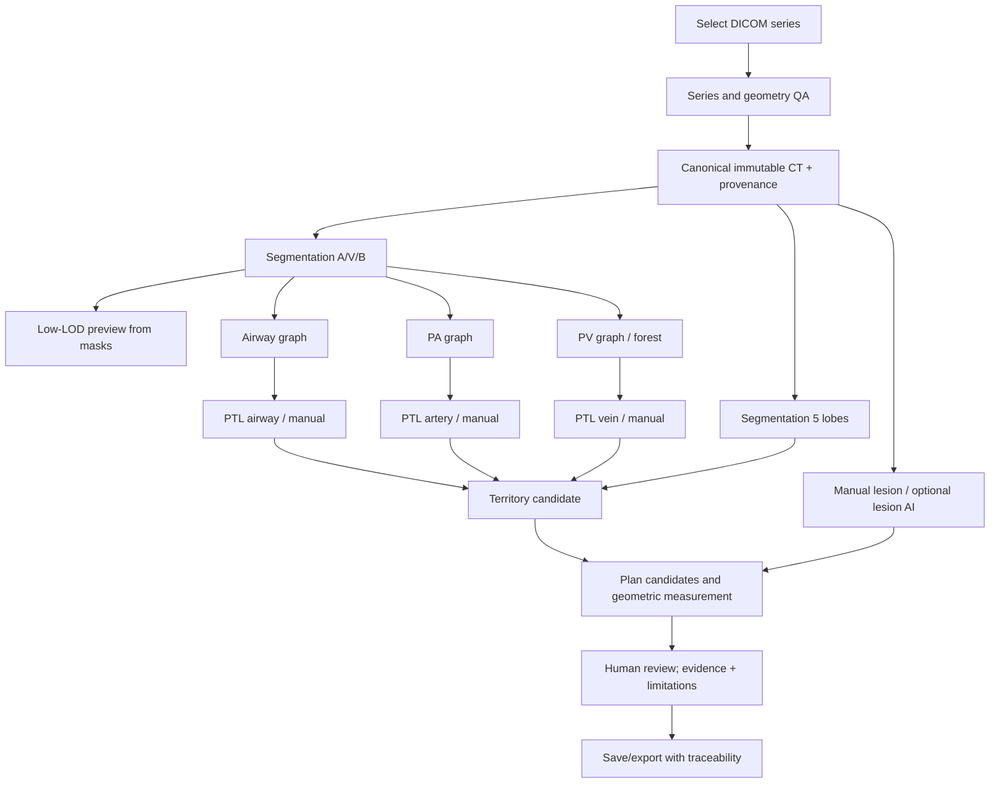

# 02 — Kiến trúc phần mềm: modular monolith UI + isolated workers

## Lựa chọn
Dùng **ports & adapters** (hexagonal architecture) để tách nghiệp vụ khỏi GUI và từng thư viện AI; chạy trên một máy cục bộ, không dùng microservice mạng, không yêu cầu DB server. Không tạo nhiều process nhỏ liên tục: một `CPU Worker` sống theo phiên và một `AMD Worker` tùy chọn; subprocess riêng cho thư viện có nguy cơ xung đột; bảo vệ bộ nhớ và cách ly lỗi.

## Các lớp, hướng phụ thuộc
- **SlicerShell/Presentation:** widget, MRML bridge, slice navigation, review UI, 3D LOD. Chỉ phụ thuộc interfaces. **Slicer main thread** nắm độc quyền sửa MRML; worker không import Slicer.
- **Application:** use cases `RunCase`, `ApproveBranch`, `CreatePlan`, `CancelJob`, coordinator/DAG, scheduler policy. Không gọi trực tiếp VTK hay Torch.
- **Domain:** immutable `CaseGeometry`, `BranchGraph`, `AnatomicalLabel`, `Territory`, `Lesion`, `Review`, `Plan`, `QualityFinding`; không phụ thuộc GUI/torch/DCMTK.
- **Ports:** `DICOMPort`, `SegmentationPort`, `GraphPort`, `LabelerPort`, `TerritoryPort`, `ArtifactStorePort`, `ResourceTelemetryPort`, `ExporterPort`.
- **Adapters:** Slicer/TotalSeg/PTL/ImPulSe/ONNX/ITK/dcmqi/Windows APIs. Có thể thay model không đổi GUI.
- **Infrastructure:** file vault, atomic artifacts, hashes, process controls, logging, signed model manifest, installer.

## Sơ đồ DAG logic

`P` không đợi PTL. Lobe và A/V/B chạy đồng thời **chỉ nếu đủ RAM/CPU**. Các graph được điều phối theo token; không đồng nghĩa luôn song song.

## Tách 3D Slicer khỏi engine
- Slicer truyền **đường dẫn file đã canonicalize trong workspace bảo vệ** + manifest phiên bản; không truyền mảng CT trong JSON hoặc qua HTTP.
- Engine ghi artifacts vào thư mục tạm, validate + hash, atomic promote, rồi mới cập nhật trạng thái.
- UI theo dõi tiến độ qua file event/IPC cục bộ, không bind port network; update Qt main thread.
- Chạy engine ngoài Slicer để kiểm soát threads/RAM/driver, dễ thay đổi Torch/ONNX.
- Failure isolation: worker crash → UI vẫn dùng được, job chuyển FAILED/RESUMABLE với error code và link tới nhật ký ẩn PHI.

## Ranh giới thời gian thực
**TTFI** mở CT; **TTF3D** có mask 3D có thể xem (không phải mesh minh họa giả); **TTLABEL** có nhãn A/V/B chưa xác nhận; **TTPLAN** có mặt phẳng/vùng và phương án đo có thể kiểm tra. Các nhãn UI phải phản ánh đúng trạng thái kết quả.

## Quyết định cốt lõi
Giữ `Segmentation source` nguyên bản; `DisplayMesh` là derivative; `MeasurementGeometry` lấy từ mask/affine nguồn. Nhánh A/V/B là các **instance objects** có unique ID và lineage; không thể chỉ lưu voxel semantic class.
